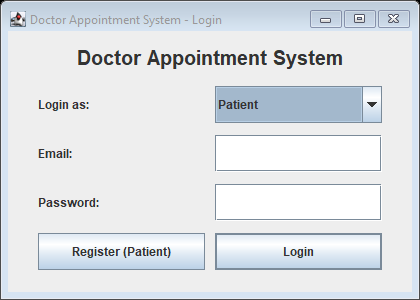
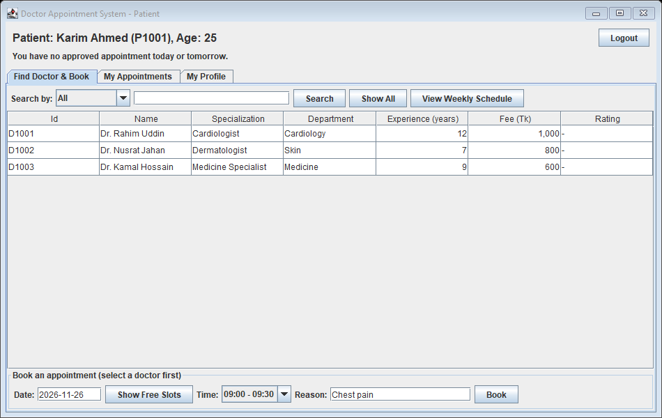
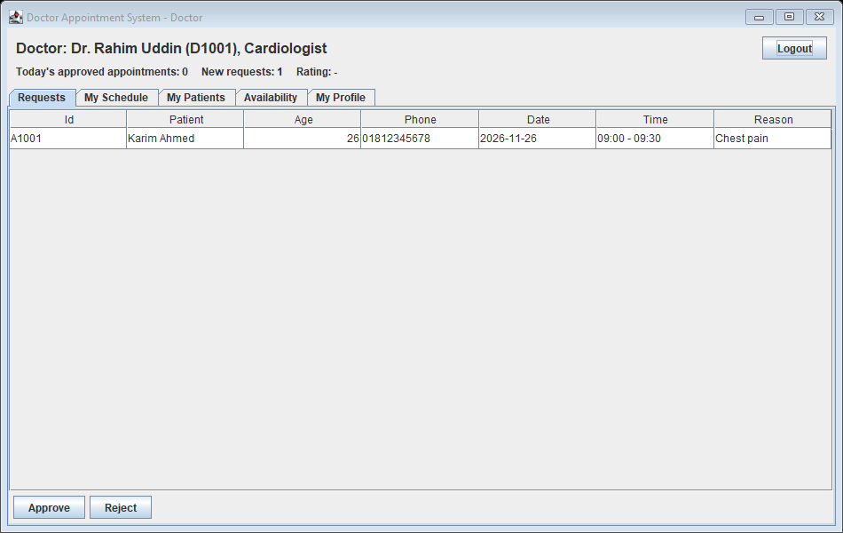
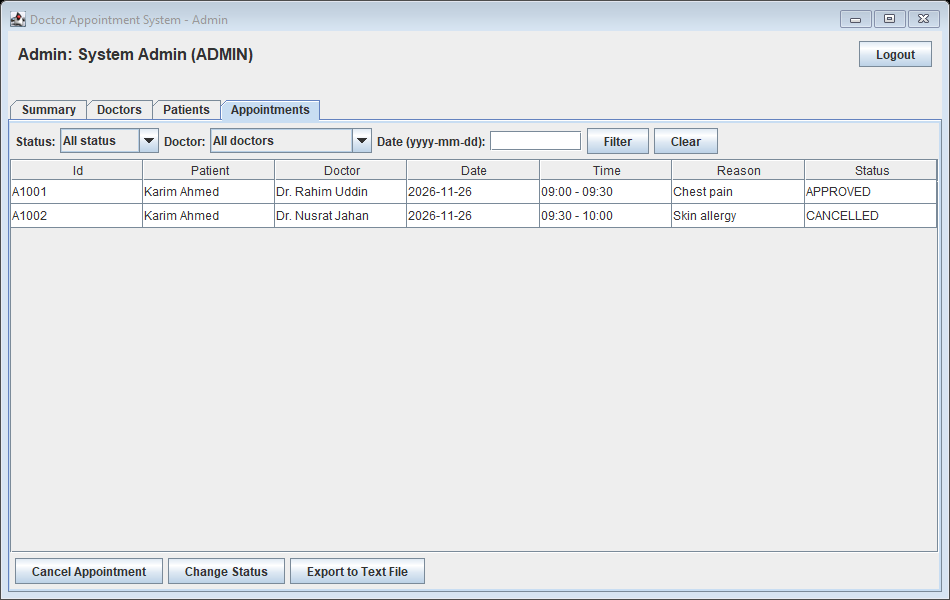

# Doctor Appointment System

A simple desktop project made with **Java** and **Swing** to practise OOP, exception handling and
file handling. No external library or database is used.






## How to run

You need JDK 11 or newer.

* **Windows:** double click `run.bat`
* **Command line:**
  ```
  javac -d out src/*.java
  java -cp out Main
  ```
* **BlueJ:** Project > Open Non BlueJ, select the `src` folder, then run `main` of the `Main` class

The program creates a `data` folder by itself in the first run and adds three sample doctors.
To start again from zero, just delete the `data` folder.

## Login information

| Role | Email | Password |
|---|---|---|
| Admin | admin@hospital.com | admin123 |
| Doctor | rahim@hospital.com | doctor123 |
| Doctor | nusrat@hospital.com | doctor123 |
| Doctor | kamal@hospital.com | doctor123 |
| Patient | press the Register button | |

## Features

**Patient**
* Register, login, edit profile
* Search doctors by name, specialization or department
* See the weekly schedule and free slots of a doctor
* Book and cancel appointments, see history and status
* Rate the doctor after a completed appointment
* Reminder for appointments of today and tomorrow

**Doctor**
* Update profile (specialization, fee, experience etc.)
* Add or remove weekly time slots (30 minutes each)
* Approve or reject requests, mark as completed
* See today's / next 7 days' schedule and the list of patients

**Admin**
* Summary (total doctors, patients, appointments)
* Add, edit and remove doctors
* Search and remove patients
* Filter appointments by status, doctor and date
* Cancel an appointment or change its status
* Export appointments to a text file

## Rules

* The same doctor and time slot cannot be booked twice
* A patient cannot have two appointments at the same time
* Booking in the past is not allowed
* Ids are made automatically (P1001, D1001, A1001 ...)
* One email can be used by only one user
* Confirmation is asked before cancelling or removing

## OOP concepts used

| Concept | Where |
|---|---|
| Encapsulation | Private fields, getters and setters with validation in `User`, `Patient`, `Doctor`, `Appointment` |
| Inheritance | `Patient`, `Doctor`, `Admin` extend `User`; the dashboards extend `DashboardFrame` |
| Abstraction | Abstract classes `User` and `DashboardFrame`, interface `Searchable` |
| Polymorphism | `User user = auth.login(...)` then `user.showDashboard(store)`; overriding `getRole()`, `displayInfo()`, `matches()`; overloading `searchDoctors()` and `getSlots()` |

## Exception handling

Custom exceptions: `InvalidLoginException`, `AppointmentConflictException`,
`DoctorNotFoundException`, `InvalidInputException`.

Also handled: `NumberFormatException`, `DateTimeParseException`, `IOException`,
`FileNotFoundException`. Errors are shown with `JOptionPane`.

## File handling

Objects are saved with serialization in `data/patients.dat`, `data/doctors.dat` and
`data/appointments.dat`. Everything is loaded at startup and saved after every change.

## Classes

| Type | Classes |
|---|---|
| Users | `User`, `Patient`, `Doctor`, `Admin` |
| Appointment | `Appointment`, `AppointmentStatus`, `TimeSlot` |
| Logic | `AuthService`, `DataStore`, `FileManager`, `Validator`, `Searchable` |
| GUI | `LoginFrame`, `RegisterDialog`, `DashboardFrame`, `PatientDashboard`, `DoctorDashboard`, `AdminDashboard`, `DoctorFormPanel`, `GuiHelper` |
| Start | `Main` |

## Limitations

* Passwords are saved as plain text because it is a learning project, so do not use a real password.
* It works on one computer only.
